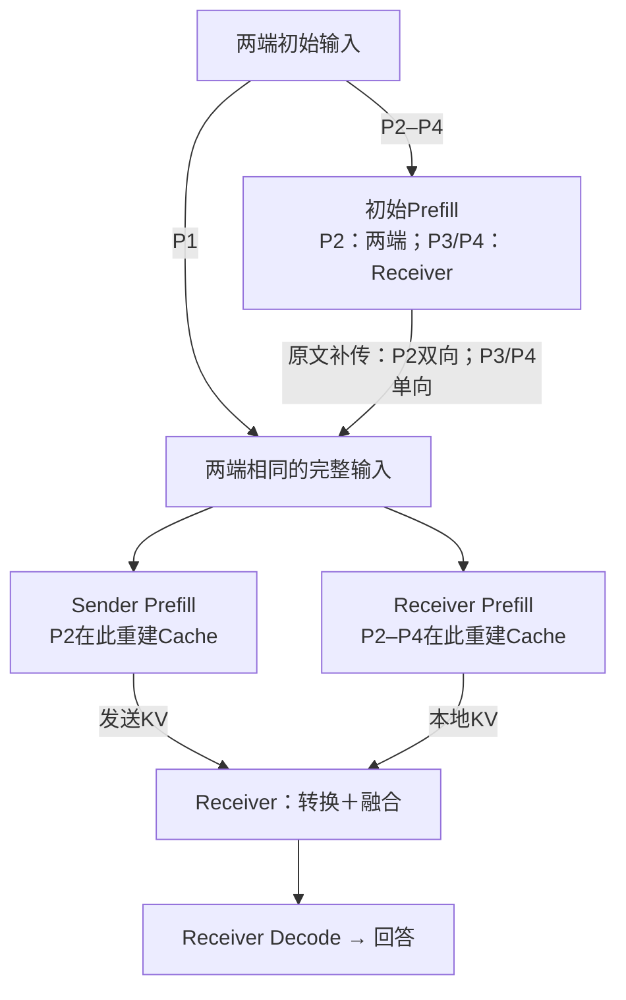

# C2C测试结果

**三方向、24个条件、97,578次生成与评分已完成。M2的数学和代码成绩最高；M3低分中存在明显的格式失分，另有真实内容错误。**

## 测试条件

- 模型均为Qwen3，方向为发送端→接收端：M1 0.6B→1.7B，M2 0.6B→4B，M3 4B→0.6B。
- 融合器沿OpenHermes训练，按验证loss选择权重。
- GSM8K main/test 1,319题；HotpotQA distractor/validation 7,405题；HumanEval 164题。
- 数学、代码测P1/P4，问答测P1–P4；问答跨协议比较取共同7,345题。

## P1 成绩

下表为P1完整测试集结果，两端起初都拥有完整任务输入。单位为%，各任务按对应的正式规则评分。

| 方向 | 数学准确率 | 问答EM / F1 | 代码pass@1 |
|---|---:|---:|---:|
| M1 | 26.91 | 10.82 / 24.07 | 43.29 |
| M2 | 69.98 | 9.16 / 27.60 | 58.54 |
| M3 | 7.51 | 0.49 / 13.37 | 25.61 |

P2–P4先补传缺失原文并重新Prefill，最终恢复为与P1相同的完整输入。

## 格式与重复损失有多大

对P1已有输出重评。数学恢复可识别的数值答案；代码仅修整包装、重复等形式后执行原测试。

| 方向 | 数学：严格→宽松数值 | 代码：原样→格式修整后 |
|---|---:|---:|
| M1 | 26.91→36.62 | 43.29→43.29 |
| M2 | 69.98→72.10 | 58.54→58.54 |
| M3 | 7.51→35.94 | 25.61→27.44 |

- **M3主要暴露格式不遵循。** 数学1,021题无法按约定抽取，其中984题缺少`####`；有些已经算对，但没有按要求标记答案。
- **M1重复与长生成比较突出。** 数学396题达到1,024-token上限，其中295题有重复线索；部分先答对再重复，仍计正确。
- **问答也存在格式失分。** 正确答案附带解释会被整段EM判错。已做120题分层语义抽查，尚无全量语义正确率。

## 通信与计算成本

**同方向、同一道题，四协议的完整KV传输包相同；总通信量＝KV包＋必要原文补传包。** 下表为KV部分的每题平均MiB，问答统一取共同7,345题。

| 方向 | 数学（1,319题） | 问答（7,345题） | 代码（164题） |
|---|---:|---:|---:|
| M1 / M2 | 14.81 | 165.38 | 26.51 |
| M3 | 19.05 | 212.64 | 34.08 |

**四协议对比：HotpotQA共同7,345题，每题均值。** 补传列是相对共同KV部分增加的实际发送量；耗时按M1 / M2 / M3排列。

| 协议 | 原文补传方式 | 额外通信（KiB） | 每题完整推理耗时（秒） |
|---|---|---:|---:|
| P1 | 无需补传 | 0.000 | 1.582 / 1.922 / 2.341 |
| P2 | 双向各补5段证据 | 6.620 | 1.702 / 2.130 / 2.537 |
| P3 | 单向补全部证据 | 6.372 | 1.604 / 1.961 / 2.413 |
| P4 | 单向补题目＋全部证据 | 6.461 | 1.625 / 1.950 / 2.400 |

**Prefill分阶段耗时：同一批题，每题均值，单位毫秒，按M1 / M2 / M3排列。** 补齐前先做初始Prefill；补齐后重新做完整Prefill，生成新的Cache。

| 协议 | 补齐前初始Prefill | Sender补齐后重建（重新Prefill） | Receiver补齐后重建（重新Prefill） |
|---|---:|---:|---:|
| P2 | 97.8 / 173.2 / 183.5 | 55.0 / 55.8 / 245.6 | 108.2 / 249.3 / 54.5 |
| P3 | 41.9 / 46.7 / 38.2 | — | 108.1 / 246.4 / 55.0 |
| P4 | 37.7 / 50.3 / 36.6 | — | 108.4 / 247.2 / 55.2 |

